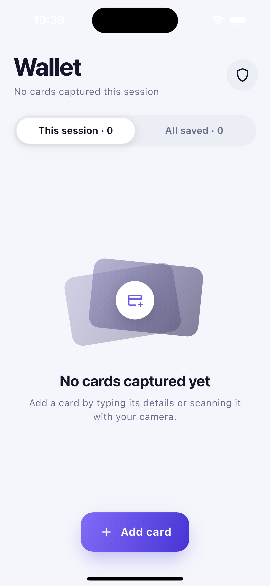
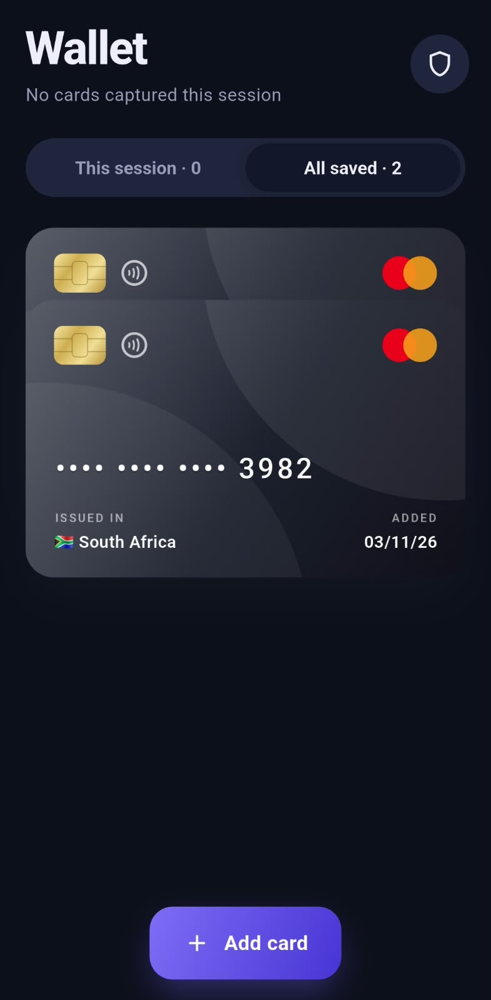
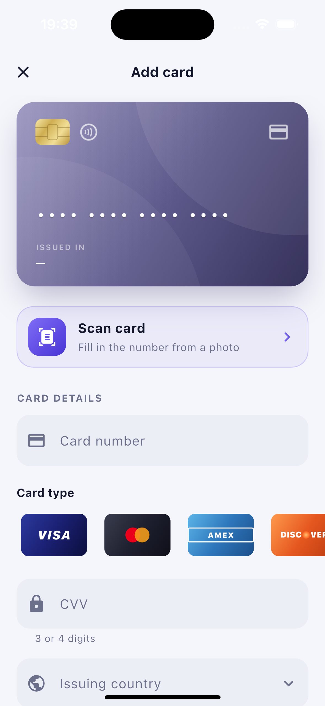

# card_validator
## Screenshots

### Wallet

### Add Card

### Banned Countries

Features

Feature	Description
Add a card	Users can enter the card number, card type, CVV and issuing country. There is also a card preview which flips when entering the CVV.
Card detection	The app detects the card network automatically from the first digits. It supports Visa, Mastercard, Amex, Discover, Diners Club, JCB, UnionPay and Maestro.
Country validation	Cards issued in banned countries are rejected.
Manage banned countries	Users can add or remove countries from the banned list. There is also an option to restore the default list.
Save cards	Valid cards are saved locally using encrypted storage.
Wallet	Displays cards added during the current session. Users can also switch to view all saved cards.
Duplicate checking	The app checks whether a card has already been added before allowing it to be saved.
Scan a card	Users can take a picture or select one from their gallery. The app reads the card number and fills it into the form automatically.

Dependencies

I tried to keep the number of external packages relatively small. These are the main packages used in the project.

Package	Purpose
flutter_secure_storage	Used to store card information securely.
shared_preferences	Stores app settings, including the banned countries list.
image_picker	Allows users to take pictures or select images from their gallery.
google_mlkit_text_recognition	Used to read card numbers from images.

Some other things are handled directly in Flutter:

* State management uses ChangeNotifier and InheritedNotifier. I didn’t use Provider.
* Country names and codes are included in the project.
* Country flags are generated using emoji instead of image files.
* Card designs and network logos are built using Flutter widgets and CustomPainter.
* The app uses system fonts, so there are no additional font dependencies.

How the app works

Card validation

Before a card is saved, the app checks a few things:

* Card number must pass the Luhn algorithm.
* Card number length must match the selected network.
* CVV must have the correct number of digits.
* The issuing country must not be on the banned list.
* The card must not already exist in storage.

These checks are also handled inside CardStore.addCard, not just in the form. This helps prevent invalid cards from being saved if the UI changes later.

Card number detection

The app looks at the starting digits of the card number to work out which network it belongs to.

For example, it can recognise Visa, Mastercard (including the 2-series range), American Express and other supported networks.

There is still an option to select the card type manually if needed.

Card scanning

The scanner uses Google ML Kit to read text from an image.

After selecting or taking a picture, the app tries to extract a valid card number. It also handles some common OCR mistakes, such as confusing O with 0 or S with 5.

The extracted number is then added to the card form.

Scanning is done locally on the device. Images are not uploaded to an external server.

Local storage

Cards are saved on the device using flutter_secure_storage.

The CVV is only used for validation and is never saved. The app stores the card number, card type, issuing country and capture date.

Project structure

Here is a quick overview of how the project is organised:

lib/
  main.dart                  App entry point
  models/                    CardType and CreditCard models
  data/
    countries.dart           Country codes and names
  services/
    card_type_detector.dart  Detects card network from Issuer ID Number
    card_validator.dart      Card validation logic
    card_format.dart         Formats card numbers
    card_scanner.dart        Image picker and OCR handling
    ocr/                     ML Kit and web OCR implementations
    card_storage.dart        Handles local card storage
    banned_countries_config.dart
  state/
    CardStore.dart           App state and card rules
  theme/
    app_theme.dart           Light and dark themes
  widgets/                   Reusable UI components
  screens/                   Main app screens
test/                        Unit and widget tests

Supported platforms

The app currently supports iOS, Android and Chrome.

Feature	iOS	Android	Chrome
Add and validate cards	Yes	Yes	Yes
Banned country checks	Yes	Yes	Yes
Duplicate card checks	Yes	Yes	Yes
Encrypted storage	Keychain	Android Keystore	WebCrypto
Screenshot protection	App switcher cover	FLAG_SECURE	N/A
Card scanning	Yes	Yes	No

Web version

Card scanning is currently only available on iOS and Android because Google ML Kit does not support web.

The project uses conditional imports to load the correct OCR implementation depending on the platform. For Chrome, a stub implementation is used instead.

The scanning option is disabled on the web version and displays a message explaining that it is only available in the mobile apps.

The layout is also adjusted for larger screens. On tablets and desktop browsers, the main content stays centred with a maximum width of 520px.

Security

Since this app handles card information, I added a few security measures to protect the stored data.

Area	Implementation
Card storage	Card data is encrypted using flutter_secure_storage.
iOS	Uses Keychain with the after-first-unlock, this-device-only setting.
Android	Uses AES-GCM encryption with the key stored in Android Keystore.
Web	Uses WebCrypto AES-GCM encryption.
CVV	Used for validation only. It is never stored.
Card display	Saved card numbers are masked. Only the last four digits are shown.
Duplicate checks	Duplicate cards are rejected before saving.
Banned countries	Every card is checked against the current banned country list.
OCR	Card scanning runs locally on the device.
Keyboard	Autocorrect and personalised suggestions are disabled on card number and CVV fields.

A few additional things worth mentioning:

* Cards saved without encryption in earlier builds are migrated to secure storage when the app starts.
* The old unencrypted data is deleted after migration.
* On Android, screenshots and screen recordings are blocked using FLAG_SECURE.
* On iOS, a blurred screen is displayed when the app becomes inactive.
* Android backups are disabled to avoid copying card data to cloud backups.
* If stored data becomes corrupted, the app clears the invalid data and starts with an empty wallet instead of crashing.

Release builds

For release builds, Dart code obfuscation can also be enabled.

flutter build apk --release --obfuscate --split-debug-info=build/symbols
flutter build ipa --release --obfuscate --split-debug-info=build/symbols

Keep the generated debug symbol files somewhere safe because they are needed when investigating crashes from obfuscated builds.

Getting started

Requirements

* Flutter 3.35 or later
* Dart 3.9 or later
* Android Studio or Xcode for mobile development

Installation

Clone the project and install its dependencies:

flutter pub get

Run tests

flutter test

The project currently has 45 unit and widget tests.

Run the app

For iOS:

flutter run -d ios

For Android:

flutter run -d android

For Chrome:

flutter run -d chrome

You can run the app on a simulator, emulator or a physical device.

A small note about scanning: Simulators and emulators usually don’t have a working camera. To test the scanning feature, use the gallery option and select an image of a card.

Xcode build issue

If your project is inside an iCloud-synced folder, you might run into this Xcode error:

resource fork, Finder information, or similar detritus not allowed

This can happen when building from folders synced with iCloud Drive. Moving the project to a normal local folder usually fixes the issue.

Test cards

The following test card numbers can be used when testing the app.

Network	Card number	CVV
Visa	4111 1111 1111 1111	3 digits
Mastercard	5555 5555 5555 4444	3 digits
Amex	3782 822463 10005	4 digits
Discover	6011 1111 1111 1117	3 digits
JCB	3530 1113 3330 0000	3 digits

These are test numbers, not real payment cards.

Banned countries

The default configuration includes:

* Cuba
* Iran
* North Korea
* Syria

You can select one of these countries when adding a card to test the rejection process.

The default list can be found here:

assets/config/banned_countries.json

You can also change the list from inside the application using the shield icon on the main screen.
